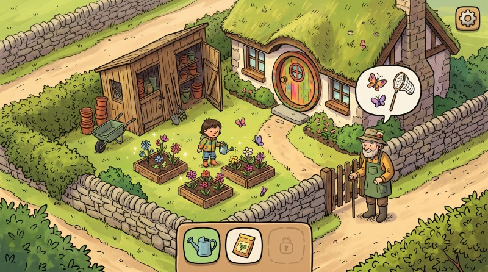

# Project My Farming Game

> **Working title:** TBD
> **Status:** 🟡 Design draft · 🟡 Godot project initialised in `src/` (4.7, C#) — no gameplay code yet
> **Design version:** GDD v0.18 · World v0.10 (both 2026-11-18)
> **Last README update:** 2026-11-18 (✅ Milestone 0 complete — all 4 items decided · 🆕 `docs/project-structure.md` added, 17 Godot/game-dev skills installed)

A gentle, fully 2D life-and-garden game for young children — mainly pre-elementary through first grade, played with a parent — that grows with the child (older children up to fifth grade are accommodated through the optional challenge layers). The player cares for a small garden, tends friendly farm animals, explores a quiet lane, and helps neighbours with everyday tasks — farming, animal care, exploration, and everyday social learning as parts of one cozy world.

Inspired by the welcoming feel of games like *Stardew Valley*, but designed specifically for children: no crop death, no animal death, no shame, no time pressure, no reading required to act. Collect picture-based items, care for animals through gentle responsibility loops, and watch the garden change with the seasons.

The game offers two modes: a **Gentle Core** that is always available and never gets harder, and **opt-in challenge layers** managed by a parent or caregiver through a grown-up menu. As the child grows, the parent can turn on layers like Words vs. Pictures, multi-step requests, garden coins, tool upgrades, crafting, and a gentle session timer (on by default) — gradually growing the game from a simple first garden into a full farming simulation. Day/night and seasons are always on: they belong to the Gentle Core, not to a challenge layer. Nothing is ever locked behind the challenge layers; the core loop always remains available.

---

## Contents

- [Project My Farming Game](#project-my-farming-game)
  - [Contents](#contents)
  - [Why this project](#why-this-project)
  - [Design pillars](#design-pillars)
  - [The core loop](#the-core-loop)
  - [Documentation](#documentation)
  - [Current status](#current-status)
  - [Roadmap](#roadmap)
    - [Milestone 0 — Design decisions](#milestone-0--design-decisions)
    - [Milestone 1 — Interaction prototype](#milestone-1--interaction-prototype)
    - [Milestone 2 — Validation](#milestone-2--validation)
    - [Later (ideas, not promises)](#later-ideas-not-promises)
  - [Technical direction](#technical-direction)
  - [How this README gets updated](#how-this-readme-gets-updated)
  - [Documentation hub](#documentation-hub)
    - [How the docs fit together](#how-the-docs-fit-together)

---

## Why this project

Most farming-life games assume a player who can already read fluently, manage an inventory, and keep a daily schedule. This one starts from the opposite end: a player who is just learning to read, who may be new to games, and who should be able to pick it up, do something satisfying, and put it down without penalty.

The differentiator is an interactive, presenter-like story woven through the gameplay — characters address the player, pause for an answer, and respond to what actually happened.

## Design pillars

1. **Easy to understand** — a child can see what to do and learn the controls by trying them.
2. **Kind and low-pressure** — mistakes are safe; nothing punishes a break or an unusual order of play. Animals nap if ignored — they never die or run away.
3. **Small, satisfying activities** — short actions produce visible, cheerful results.
4. **Creative ownership** — personalize a garden without needing to optimize it.
5. **Warm illustrated world** — expressive characters, clear shapes, non-pixel-art children's-book style.
6. **Practice everyday social skills** — greeting, asking, taking turns, offering help, repairing a misunderstanding.
7. **Collectathon inventory** — picture-based slots, auto-stacking, and a collection book give kids the joy of collecting without inventory stress. No currency, no sorting, no "full" penalty.
8. **Gentle animal care** — caring for farm animals teaches responsibility through positive care loops. Animals nap if ignored — they never die, run away, or become permanently unhappy.
9. **Progressive challenge (opt-in)** — optional stickers, multi-step requests, and seasonal mysteries grow with the child's skill when a parent turns them on. Nothing is ever locked behind them; the core loop always remains available.
10. **The parent is the difficulty dial** — challenge layers are turned on or off by a parent or caregiver through a grown-up menu. The game never auto-scales based on age or playtime. Gentle Core remains available at every stage.

> **Core vs. layers:** Day/night, seasons, and the seasonal calendar are always on (Gentle Core — see `docs/mechanics.md` §2–§3). The Session Timer layer is the one layer that defaults to **on**; all others default to off.

## The core loop

1. Decide what you'd like to do, find, or unlock.
2. Explore, tend the garden, or talk to a character to find a way forward.
3. Help someone with a clear task in exchange for an agreed reward.
4. See an immediate response; some rewards open a new activity, tool, or place.
5. Enjoy the new possibility — or pick another goal.

The first beat is **The Butterfly Garden**: plant and water three flowers for Mr. Marlow and earn a butterfly net, which unlocks bug-finding as a brand-new verb.

## Documentation

The [Game Design Document](./docs/GDD.md) is the **single source of truth** for gameplay, audience, and project decisions. This README is the **project-wide summary and navigation hub** for everything else. Every document in `docs/` carries its own status header, open-question list, and change log — read the change log before editing so the version history stays coherent. For the full list, see the [Documentation hub](#documentation-hub) below.

## Current status

Where the project actually is right now:

- [x] Initial brief captured
- [x] Design pillars and audience defined
- [x] Core loop and first reward beat proposed (Butterfly Garden)
- [x] Rules/difficulty guardrails written (no crop death, no shame, no timers)
- [x] Art direction narrowed (angled top-down, earthy base + bright accents, non-chibi, non-pixel)
- [x] Background-story premise written (Bramblewick Lane, Mr. Marlow)
- [x] Engine selected — **Godot 4.x with C#**
- [ ] Repository scaffolding (project folder, build running)
- [ ] First playable prototype
- [ ] First playtest with a child
- [ ] Decisions made on the open questions below

No game code yet. The engine is chosen (Godot 4.x with C#); the current milestone is **building the smallest scene** that answers the interaction questions (Phase-001 — see `PHASE.md`).

## Roadmap

### Milestone 0 — Design decisions
- [x] Choose engine — **Godot 4.x with C#** (see [Technical direction](#technical-direction))
- [x] Decide in-session growth timing and closed-game growth policy — **Medium ≈30–45 s per stage, no growth while closed** (Fast/Slow presets + optional positive-only "Gentle catch-up" on the options screen before starting a new game; see `docs/GDD.md` §4)
- [x] Decide whether there is any in-game clock — **yes: a coarse stepped clock in the HUD.** 8 day phases × 3 in-game hours, jumping one 3-hour step at a time (≈3 min of play per step, ≈24-min in-game day), running only while playing. Drives atmosphere, NPC presence, and events only — never growth or penalties (`docs/GDD.md` §4)
- [x] Resolve the open story questions in `docs/world.md` §7 that affect the first minute of play — **all 7 resolved** (newcomer from the city · lane's memory unnamed, used as a literary device · Marlow "a+" knowledge rule · ledger = both, world-only · heirloom house + Ada the family friend · Marlow name kept · Lantern Hill is a horizon)
- [x] Record chosen PC control mappings — **gamepad table confirmed + Don't Starve Together-style keyboard/mouse** (WASD or click-to-move, left-click = walk to it then act, Space = quick action, right-click = cancel, wheel = belt, Esc = pause). **Seat rule:** keyboard + mouse is locked to one player; the second player needs a gamepad, otherwise co-op does not start (`docs/controls.md` §2–§4). Back/Select help tooltip deferred.

### Milestone 1 — Interaction prototype
One small playable scene, placeholder art, for validating feel rather than visuals:
- [ ] Controllable character (gamepad + full-mouse schemes)
- [ ] One garden bed, basic seeds, and the task's flower seeds
- [ ] Plant and water interactions
- [ ] Visible growth/progress feedback
- [ ] NPC picture-bubble want and clear task request
- [ ] Butterfly net reward → simple butterfly-finding interaction
- [ ] Garden shelf that receives harvests automatically
- [ ] Local save

### Milestone 2 — Validation
- [ ] Playtest questions from `docs/GDD.md` §14 answered with adult-supervised play
- [ ] Decide: does the loop hold up before adding features?
- [ ] Confirm fixed tool belt and shelf feel right (no loose inventory)

### Later (ideas, not promises)
- Second small area (brook, footbridge, allotment)
- More plants, characters, decorations
- Giving/sharing interactions and structured parent-child activities
- Touchscreen adaptation (iPad / Android tablets first)
- Relationship meter and high-relationship events

Explicitly deferred from the prototype: large maps, crafting/economy depth beyond collectathon slots, detailed real-time calendars, combat, online multiplayer, long reading-heavy dialogue.

**In product-prototype scope** (source of truth: GDD §15, delivered across phases — see `PHASE.md`): Collectathon inventory, four care animals (chicken, sheep, cow, beehive), seasonal crop and animal behavior, optional sticker system, Dora/Blues Clues-style picture dialogue with parent guidance.

## Technical direction

**Prototype platform:** PC. **Longer-term goal:** multiplatform, iPad and Android tablets prioritised for touch.

**Engine:** **Godot 4.x with C#** (chosen). Selected against:
- 2D workflow and art pipeline (illustrated, non-pixel assets) ✓
- Speed of PC prototyping ✓
- Future touch input without rewriting activities ✓
- Eventual multiplatform deployment ✓
- The team's existing experience ✓

The first technical prototype must answer movement, planting, watering, growth feedback, and saving **before** substantial content production starts.

## How this README gets updated

This file is meant to be edited as the project develops. Suggested conventions:

- **Bump `Last README update`** every time you touch this file, using `YYYY-MM-DD`.
- **Tick checkboxes** as things land; add new items rather than rewriting sections.
- **Move work from "Current status" → "Roadmap" → "Done"** as it happens.
- **Bump version numbers** in each document's own header and change log (the change log is the source of truth for that document); mirror the GDD version in the header here. The GDD is the single source of truth for gameplay and project decisions.
- **When the working title is chosen**, replace "Project My Farming Game" in the header and the `Working title` line.
- **When the engine is chosen**, fill in [Technical direction](#technical-direction) and note the decision in the GDD change log.
- Keep this file an honest snapshot: if something is speculative, label it as a proposal.

---

## Documentation hub

This README is the centralized navigation hub for the project. Every design document lives in `docs/` and cross-links to the others. The **[Game Design Document](./docs/GDD.md) is the single source of truth** for gameplay decisions; **this README is the project-wide summary** for readability and navigation. Start with the GDD, then branch out to the documents below.

| Document | What it covers |
|---|---|
| [Game Design Document (`docs/GDD.md`)](./docs/GDD.md) | Authoritative source for gameplay, audience, design pillars, core loop, milestones, open questions, and technical direction. |
| [World, Setting & Background Story (`docs/world.md`)](./docs/world.md) | Bramblewick Lane premise, Mr. Marlow, the seed-shed ledger, places, lore, and the Butterfly Garden story beat. Expands the GDD's setting direction. |
| [Characters (`docs/characters.md`)](./docs/characters.md) | Main player character, parent/caregiver co-play role, Mr. Marlow (NPC), seasonal visitor, and future cast. |
| [Places (`docs/places.md`)](./docs/places.md) | The eight places on Bramblewick Lane: home, lane, Mr. Marlow's cottage + seed shed, allotment beds, brook & footbridge, market stand, stile, Lantern Hill. |
| [Crops (`docs/crops.md`)](./docs/crops.md) | Crop list, growth model, seasons, starting seeds, Butterfly Garden flowers, and later seasonal crops. |
| [Animals (`docs/animals.md`)](./docs/animals.md) | Chicken, sheep, cow, and beehive — gentle care meters, seasonal behavior, and collectathon products; plus the lane's ambient creatures. |
| [Items (`docs/items.md`)](./docs/items.md) | Starting loadout (hands, watering can, seed box), earned items (butterfly net), grown crops, decorations, and NPC-held items. |
| [Inventory System (`docs/inventory.md`)](./docs/inventory.md) | Collectathon slot categories, auto-stacking, Overflow Nest at Marlow's shed, Collection Book. |
| [Mechanics (`docs/mechanics.md`)](./docs/mechanics.md) | Core verbs (move, interact, plant, water, harvest, find & catch, sleep, decorate, talk/give, feed, brush, collect), day/night cycle, seasons, tool belt, co-play. |
| [Controls (`docs/controls.md`)](./docs/controls.md) | Xbox gamepad, mouse, and touchscreen control mappings; co-play schemes; calendar UI. |
| [Events (`docs/events.md`)](./docs/events.md) | Core events (Butterfly Garden task), daily/ambient events, seasonal events, relationship milestones. |
| [Progressive Challenge & Sticker System (`docs/progression.md`)](./docs/progression.md) | Sticker book, optional neighbour requests, optional tools, seasonal mysteries, parent role evolution. |
| [Challenge Layers & Parent Controls (`docs/challenge-layers.md`)](./docs/challenge-layers.md) | Optional challenge layers, parent-controlled toggles, five-stage growth map, one-click reset. |
| [Project Structure (`docs/project-structure.md`)](./docs/project-structure.md) | Technical contract for coding sessions: repository and `src/` folder layout, Phase-001 task→file map, naming rules, InputMap and autoload registries, asset/placeholder pipeline, version-control rules, headless verification commands, installed AI skills, open toolchain blockers. |

### How the docs fit together

- **[README.md](#)** — This file. Centralized hub and honest project snapshot. Bumped when the project changes.
- **[docs/GDD.md](./docs/GDD.md)** — Authoritative for gameplay, audience, and project decisions. All other docs expand it.
- **[docs/world.md](./docs/world.md)** — Expands the GDD's setting; the GDD remains authoritative for gameplay.
- **[docs/project-structure.md](./docs/project-structure.md)** — The technical (non-gameplay) contract: where code and assets live, how they are named and verified. Never overrides the GDD or a phase task.
- **Everything else** — Expands the GDD and/or world.md in a specific domain (characters, places, crops, animals, items, inventory, mechanics, controls, events, progression).

Every document includes a "Related documents" section at the end so you can follow links from any page to any other page.

---

*License: TBD.*