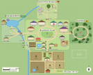

# Places

> **Status:** Brainstorming draft — **world map redesigned 2026-11-20 (Bramblewick Vale)**
> **Version:** 0.15
> **Last updated:** 2026-11-21
> **Purpose:** The places the player can explore. The lane is now the road into **Bramblewick Vale**, a small valley of **five areas plus Kit's farm** (owner decision 2026-11-20, replaces "one lane, eight places, no map"). Sizes, layout, unlocks, and navigation rules live here; the story of each place lives in [world.md](./world.md). All names are tentative and every element is a proposal pending playtesting.

---

## 1. Scope and design intent

- **Hub and four spokes.** Bramblewick Green (the village, reached up the lane) is the hub in the middle of the valley. Kit's farm is to the south; Brookside & Mill Pond to the west; Hazel Wood to the east; Lantern Hill & Old Quarry to the north.
- **Big enough to explore, small enough for a 6-year-old.** Every area is at most two exits from the farm, and the farthest spot is about 36 seconds' walk from the front door (§4).
- **Gentle locks, never parent gates.** Areas open at existing farm tiers (progression.md §3) or through lane restoration (progression.md §6.4). Each closed path shows a picture of what opens it.
- **The valley is fixed.** Five areas plus the farm; no more areas are added by later content. The farm's land does not change size either (buildings.md §2). Growth inside the valley comes from people, restoration, and what Kit builds.
- Each area is its own level scene, swapped by `Main` through edge exits with a short fade (project-structure.md, scene architecture).

**Map:** [`assets/map/bramblewick-vale.svg`](./assets/map/bramblewick-vale.svg) — drawn to scale, 1 grid square = 10 × 10 tiles.



---

## 2. Areas

Scale: **1 tile = 1 m** (64 px in the 2D build; in 3D since 2026-11-21 one tile is one metre on the ground plane). The fixed camera shows about **20 × 11 tiles** at 1280 × 720 (one "screen"), the framing target for the 3D camera too (Phase-001 Task 1.14). The 3D camera is **diagonal** (owner 2026-11-21), so map north points up-and-to-the-side on screen and the house and barn doors (facing north) are on the far side from the camera — whether to turn them is an owner question for Task 1.15.

| Area | Size (tiles) | Tiles | ≈ Screens | Opens | What it's for |
|---|---|---|---|---|---|
| **Bramblewick Green** (village + lane) | 64 × 44 | 2,816 | 12.5 | Day 1 | The hub: orders, seeds, selling, shops, festivals, most neighbours |
| **Kit's farm** | 50 × 32 | 1,600 | 7 | Day 1 | Farming, animals, building, automation |
| **Brookside & Mill Pond** | 34 × 36 | 1,224 | 5.5 | Near bank Day 1 · far bank T3 · watermill T4 | Fishing, foraging, catching fish for the farm pond, the butterfly mystery |
| **Hazel Wood** | 32 × 30 | 960 | 4 | T2 | Foraging (mushrooms, nuts, herbs), wood, Collection Book finds |
| **Lantern Hill & Old Quarry** | 30 × 27 | 810 | 3.5 | T5 | The story's finale (relight the lantern), stone and fossils, the lookout, Winter Lantern Night |
| **Whole valley** | | **7,410** | **≈ 33** | | |

### 2.1 Bramblewick Green (village and lane)

The lane runs north from Kit's farm gate past Mr. Marlow's cottage, then opens onto the village green. Every building faces **one ring path** around the green, so walking the ring passes every door. Exits: north (stile → Lantern Hill), west (→ footbridge, Brookside), east (→ Hazel Wood), south (the lane → Kit's farm).

| Place | Who | What Kit does there | Opens |
|---|---|---|---|
| **Mr. Marlow's cottage + seed shed** (on the lane) | Mr. Marlow | Seeds and saplings, the **village noticeboard** (help wanted, festivals, community projects — no orders from Phase-002; Marlow's own orders come from a sign on his cottage door, 2026-11-21), the ledger, the early building catalogue | Day 1 |
| **Berry bushes along the lane** | — | The first order (wild berries) | Day 1 |
| **Market stand** | Travelling merchant on visit days | Trading and rare goods on visit days. **Kit's own stall is deferred to a later phase** (owner 2026-11-21: one way to sell at a time — the shipping box first; if the stall returns, Kit sets prices and leaves it) | Visible Day 1; Kit's stall later |
| **Allotments** | The allotment neighbour | Shared beds; vegetable orders | Visible Day 1; opens after the first crop order (T1, owner 2026-11-21) |
| **Bakery** | The baker | Egg, flour, and fruit orders; bread and pie recipes | After Kit's first eggs (T1, owner 2026-11-21) |
| **General store** *(new)* | The shopkeeper | Kitchen ingredients (sugar, salt, jars), bag upgrades, decorations. Seeds stay at Marlow's; feed is still ordered by phone (economy.md §2) | After five delivered orders (T1, owner 2026-11-21) |
| **Village hall** *(new)* | Everyone | Festivals and contests (Spring Bloom, Harvest), winter events, the meeting place for each lane restoration project | T2 (first festival) |
| **Smithy** *(new)* | The smith | Tool upgrades, paid with coins and the stone and wood from clearing | T3 |
| **Friend's family cottage** *(new)* | The friend of Kit's age and their parents | Friendship, festivals, contests | T3 |
| **Clinic** *(new)* | The village nurse | Orders for healthy food (fruit, herbal tea, honey, soup) and picture lessons on eating well. **Nobody gets sick** — the GDD's "no sickness, no vet" rule stands | T4 |
| **Carpenter's yard** *(new)* | The carpenter | House upgrades and the big late buildings (greenhouse, farm shop); Marlow keeps the early catalogue | T4 |
| **Library & schoolroom** *(new)* | The librarian | Picture books about crops, animals, weather, and the brook; each book read adds a Collection Book page | T4 |
| **Cottages (×3)** *(new)* | Villagers who become farmhands | Where farmhands live; they walk to Kit's farm each morning and home each evening (GDD §4) | T2 |
| **Inn** *(new)* | The innkeeper | Rooms where the travelling merchant, the Hill Visitor, and festival guests stay; its kitchen gives catering orders | T5 |
| **Duck pond, playground, well** | — | Small things to look at and play with; ducks to feed | Day 1 |

Before a building's person is met, it shows a picture "closed" sign and a **trace** of its owner (world.md §3.4).

### 2.2 Brookside & Mill Pond

| Place | What it is | Opens |
|---|---|---|
| **Near bank** | East side of the brook: berries, reeds, a frog, the first fishing spots; laundry on a line (trace for the brook keeper). Stepping stones lead down to the farm's west corner | Day 1 (early exploration reward) |
| **Footbridge** | The crossing from the village's west exit | Repaired as the **first lane restoration project** (T3) |
| **Butterfly meadow** | Wildflowers on the far bank; the butterfly mystery and the Butterfly Garden request | T3 |
| **Brook keeper's cottage** | Home of the brook keeper | T3 |
| **Mill Pond + old watermill** | A wider pool upstream with rarer fish; the watermill turns again as the **second restoration project** and grinds flour | Pond T3 · watermill T4 |

### 2.3 Hazel Wood

One loop path through the trees, with a mushroom ring in the middle and a hollow tree on the far side. Foraging (mushrooms, hazelnuts, herbs), fallen branches for wood, birds. Nobody lives here. **Opens at T2:** a fallen log blocks the entrance with an axe picture on it; Kit's first axe (a T2 tool) clears it.

### 2.4 Lantern Hill & Old Quarry

Reached through the **stile** at the village's north exit. A winding path climbs to the broad oak, the old unlit lantern post (trace for the seasonal visitor), and a **lookout** that shows the whole valley. On the hill's west side, a shallow, safe **old quarry** gives stone, rare stones, and fossils for the Collection Book (no mine, no caves). **Opens at T5** as the last restoration project: rebuild the stile, then relight the lantern.

---

## 3. Kit's farm (50 × 32)

The farm keeps exactly the land in buildings.md §2 — front garden plus Fields A–E, **992 tiles** — packed tightly around the house:

```
              gate (lane to the village)
   +--------------------------------------------------+
   |  Field D   |  front garden + coop  |   Field C   |
   |  16 x 12   |  house (centre)       |   16 x 12   |
   |------------+-----cross path--------+-------------|
   |  Field E          |  Field A   |  Field B        |
   |  20 x 16          |  12 x 10   |  12 x 10        |
   |  natural pond 4x4 |  old barn  |  animal yard    |
   +--------------------------------------------------+
   ^ brook along the west edge
```

- **Top row:** Field D (west), the house with the front garden and old coop facing the gate (centre), Field C (east).
- **Bottom row:** Field E along the brook (west) with the **natural pond**, Field A directly **behind the house** with the **old barn** at its back edge, Field B (east).
- **One cross-shaped path** (2 tiles wide) joins every field to the front door. Most beds are within 25 tiles (≈ 10 s) of the door; the farthest corner of Field E is ≈ 40 tiles (≈ 16 s).
- **Animal yard:** a 12 × 6 strip beside the old barn, free from the start, fits a second barn (6 × 5) and a big coop (6 × 4) side by side.
- **Shipping box** (Phase-002, owner 2026-11-21): beside the front door, 1 × 1 on the front-garden path, so filling it is on the way to bed; picked up when Kit sleeps (mechanics.md §5).
- Fields are fixed in size and place; **what goes inside them is flexible** — once cleared, any tile can hold beds or buildings, and buildings move freely (buildings.md §5).
- **Water:** the natural pond in Field E is fed by the brook; new water must connect to it (buildings.md §3.1).

---

## 4. Walking times

Kit walks **2.5 tiles/s** (Task 1.2); one in-game hour is **60 real seconds** and time stops indoors and in menus (GDD §4, Task 1.3). So 1 tile ≈ 0.4 s ≈ 0.4 in-game minutes.

| From the front door to | Tiles | Real time | In-game time |
|---|---|---|---|
| Marlow's seed shed | ≈ 20 | 8 s | 8 min |
| The green (centre) | ≈ 39 | 16 s | 16 min |
| Quarry | ≈ 74 | 30 s | 30 min |
| Mill Pond or the hollow tree (farthest) | ≈ 90 | 36 s | 36 min |

A round trip to the farthest spot costs about **1.2 in-game hours** of Kit's 04:30–21:30 day. If that feels long in playtest, the outer areas can shrink without moving anything else.

---

## 5. Navigation rules (ages 6+)

- **Home is always down.** The farm is at the bottom of the valley; walking down from anywhere leads home. Every area is at most two exits from the farm.
- **Picture signs.** Every exit and shop has a picture sign (fish, mushroom, lantern, loaf, red cross) in the same place on screen; no reading needed.
- **One loop per area.** No mazes, dead ends, or dark caves; side paths return to the main path.
- **Picture map in the pause menu.** A painted map of the valley with Kit's face and icons for where today's orders go; closed areas show as gentle fog. No separate map button (controls.md).
- **Order signs at the door (owner 2026-11-21).** A neighbour's house that wants something shows a **basket on the doorstep with a picture note**, visible from the path. Only a few houses have a sign on any day, and some never order. Kit visits houses one by one; walking the green's ring path passes every door. Knocking brings the neighbour to the door to talk and give the order; the goods are sent later through the shipping box.
- **Same controls everywhere.** Leaving an area is walking off its edge; nothing new to press on any gamepad.
- **Nothing far is required.** Orders only ask for things from areas already open; the farm alone is enough to play the whole game.

---

## 6. Visual character (from world.md §3.3)

- **Hobbiton-adjacent, not Hobbiton:** Grass-grown roofs, bright doors, stone walls, picket fences, laundry lines, wheelbarrows, terracotta pots, hand-painted signs. Avoid hobbit proportions, pipe-weed, and direct copies.
- **Earthy base, bright accents:** Subdued greens, browns, and stonework; saturated flowers, doors, seed packets, and characters pop against it.
- **Everything is small and made by hand:** Nothing industrial, nothing looming. The village is a cluster of cottages around a green, not a town; the largest object is still the oak on Lantern Hill.
- **Time and season variants:** door and window light show day vs night; gardens, the meadow, and the wood change by season; fireflies over the brook on summer nights; the lantern relit on Winter Lantern Night.

---

## Related documents

| Document | Relationship |
|---|---|
| [README.md](../README.md) | Centralized hub for the project. |
| [GDD.md](./GDD.md) | Scope and audience; §7 summarises the valley. |
| [world.md](./world.md) | Premise, setting, and lore of each place (§3). Area names are kept in sync between the two documents. |
| [characters.md](./characters.md) | Who lives where. |
| [buildings.md](./buildings.md) | The farm's land, buildings, and water tiles. |
| [progression.md](./progression.md) | Farm tiers that open areas; the lane restoration ladder. |
| [events.md](./events.md) | Arrivals, festivals, and restoration events, and where they happen. |
| [animals.md](./animals.md) | Animals on the farm; fish in the brook, Mill Pond, and the farm pond. |

---

## 7. Change log

- **0.1 — 2026-11-18:** Initial draft. Six places aligned with world.md, plus day/night and season variant notes. Stile and Lantern Hill marked as locked/deferred long-arc content.
- **0.2 — 2026-11-18:** Added the Market Stand as a parent-unlocked place for the Garden Coins challenge layer. Noted that new places are parent-unlocked.
- **0.3 — 2026-11-18:** Added trace objects (seed packet, footprints, birdhouse, laundry) and per-place presence schedules so each place feels inhabited before its character is formally introduced.
- **0.4 — 2026-11-18:** Recounted to **eight places** (stile and market stand were already listed here; world.md now matches). Brook unlock changed to "earned early through exploration" (early exploration reward). Added the unlit-lantern trace to Lantern Hill.
- **0.5 — 2026-11-18:** Player's home updated per world.md §7.5: **family heirloom** cottage, **overgrown-never-derelict** art rule (no decay, no rubbish, no loneliness), arrival props (boxes + cart at the gate) added as interactive/trace objects.
- **0.6 — 2026-11-19:** **Direction reset (GDD v0.19).** Parent-unlocked places removed. Added **§2.1 Kit's farm** (front garden + five fields behind the house, bought/cleared over time). Seed shed hosts the order board and building catalogue; market stand is the selling place and merchant spot, Kit's stall from T2; brook gains fishing and forage; stile and Lantern Hill reopen via lane restoration. Stage references replaced with farm tiers.
- **0.7 — 2026-11-19:** Back fields are owned from the start and cleared, not bought (owner decision); sizes in buildings.md §2.
- **0.8 — 2026-11-19:** Old coop (front garden) and old barn (edge of Field A) noted as starting buildings.
- **0.9 — 2026-11-19:** Starting animals noted (5 hens in the coop, 1 cow in the barn).
- **0.10 — 2026-11-20:** **World map redesigned as Bramblewick Vale (owner decision).** "One lane, eight places, no map" replaced by a hub-and-spokes valley: Bramblewick Green (village + lane, 64 × 44, the biggest area) with a bakery, general store, village hall, smithy, clinic (no sickness), carpenter, library, inn, cottages, duck pond and playground; Brookside & Mill Pond (west), Hazel Wood (east), Lantern Hill & Old Quarry (north). Area sizes, unlock tiers, walking times (60 s per in-game hour), navigation rules for ages 6+, and a pause-menu picture map added. Kit's farm repacked to 50 × 32 around the house (same 992 tiles) with an animal yard. To-scale map in `assets/map/bramblewick-vale.svg`. Market stand moved to the green.
- **0.11 — 2026-11-20:** **Farmhands first, machines later (owner decision 2026-11-20):** the villagers' cottages open at T2; farmhands walk to the farm and back each day.
- **0.12 — 2026-11-20:** **Windmill / water pump removed (owner decision 2026-11-20):** the carpenter no longer sells it.
- **0.13 — 2026-11-21:** **Selling and house-visit orders (owner decisions 2026-11-21).** Kit's market stall deferred to a later phase (the market stand stays for the travelling merchant); the **shipping box** placed beside the farmhouse door (§3); new navigation rule: **order signs** — a basket with a picture note on a neighbour's doorstep shows a house that wants something; Kit knocks and talks to the neighbour, and sends the goods through the shipping box. The bakery, allotments and general store open in T1 when their neighbour arrives; Marlow's board becomes the village noticeboard (no orders).
- **0.14 — 2026-11-21:** Scale note for the **3D switch** (owner decision 2026-11-21): 1 tile = 1 m on the 3D ground; the 20 × 11-tile screen stays the camera's framing target. Sizes and walking times unchanged.
- **0.15 — 2026-11-21:** Diagonal 3D camera (owner 2026-11-21): map north is no longer screen-up; north-facing doors flagged for Task 1.15. Layout unchanged.
